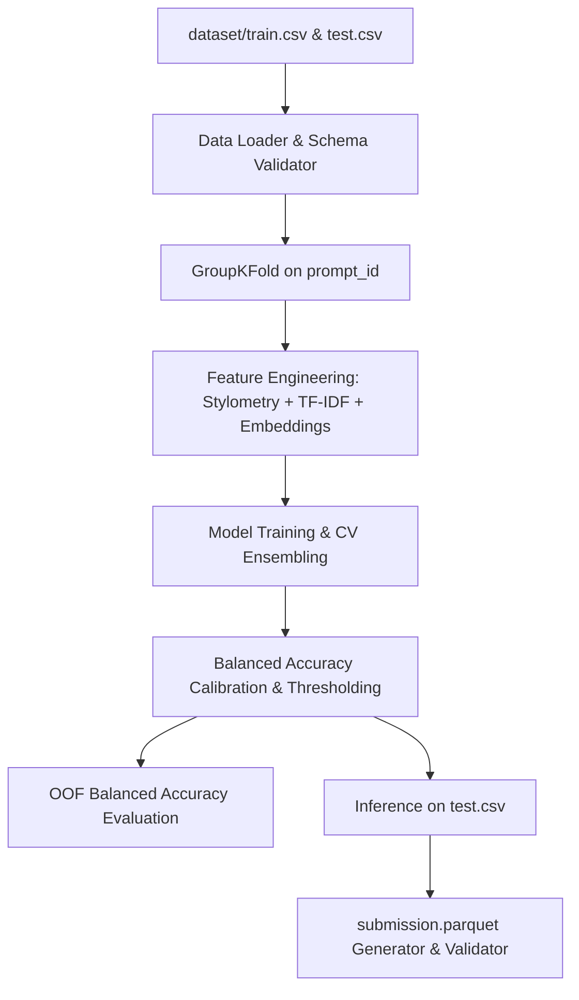

# harness.md — Name That LLM

> Single source of truth for the "Name That LLM" attribution engineering harness.
> Derived from `docs/raw.md` and repository inspection.

---

## 1. Problem Statement

Modern Large Language Models (LLMs) from frontier labs generate text across numerous disciplines.
Detecting which specific frontier model authored a given passage (~40 to 250 words) is vital for auditing synthetic data, provenance tracking, and detecting benchmark contamination.
This Kaggle Code Competition challenges us to classify ~4,000 unlabeled text passages across 18 frontier LLMs from 6 providers:
OpenAI, Google, Anthropic, Qwen, ZAI, and Moonshot AI.

Source problem definition: [raw.md](file:///D:/WorkSpace/Project/namethellm/docs/raw.md).

Key Data Characteristics:
- **Training Set (`dataset/train.csv`)**: 2,699 passages across 150 prompt IDs (`prompt_id`). Balanced across 18 classes (~150 samples per class; `claude-fable-5` has 149).
- **Test Set (`dataset/test.csv`)**: 3 rows interactively; ~4,000 hidden test rows during evaluation.
  Crucially, test passages are written for prompts that **do not appear** in `train.csv`.
- **Target Variable**: 18 candidate models:
  `gpt-5.5`, `gpt-5.6-luna`, `gpt-5.6-sol`, `gpt-5.6-terra`, `gpt-6-astra`,
  `gemini-3.1-pro-preview`, `gemini-3.6-flash`, `gemini-3.7-flash`, `gemini-3.8-flash`,
  `claude-fable-5`, `claude-opus-4-6`, `claude-opus-4-8`, `claude-opus-5`, `claude-sonnet-5`,
  `qwen3.8-max`, `glm-5.3`, `glm-5.3-flash`, `kimi-k3`.
- **Metric**: Balanced Accuracy (macro-average per-class recall across the 18 candidate models).
- **Output Artifact**: `submission.parquet` with columns `id` (str) and `model` (str).

---

## 2. Goals & Non-Goals

### 2.1 Goals
- Build a cross-validation strategy strictly grouped by `prompt_id` (GroupKFold / StratifiedGroupKFold) to accurately simulate unseen test prompts.
- Implement stylistic, punctuation, vocabulary, and token fingerprinting features robust to topic variation.
- Train high-performing multi-class classifiers (TF-IDF + linear baselines, gradient-boosted trees, and embedding/transformer representations).
- Implement post-processing and calibration tuned directly for the Balanced Accuracy metric.
- Package an autonomous, deterministic, offline-capable pipeline that outputs a valid `submission.parquet`.
- Enforce the harness engineering operating standard: self-testing, zero unverified assumptions, automated quality gates G0–G5.

### 2.2 Non-Goals
- Human-vs-AI binary classification (we focus strictly on 18-class attribution among frontier LLMs).
- Using external live APIs during inference (inference runs in an offline Kaggle sandbox).
- Overfitting to prompt topics (topic keywords must not dominate stylistic fingerprinting).
- Interactive web frontend or REST API deployment (this is a Kaggle code competition submission).

---

## 3. Users & Use Cases

- **Kaggle Competitor / Evaluator**: Runs offline training, validates local CV, generates Kaggle-compliant `submission.parquet`.
- **Synthetic Data Auditor**: Inspects stylistic feature importance to understand distinctive hallmarks across model families (OpenAI vs Google vs Anthropic vs Qwen vs ZAI vs Moonshot).

---

## 4. Requirements

| ID | Statement | Priority (MoSCoW) | Source |
|---|---|---|---|
| `REQ-001` | Ingest and validate `train.csv`, `test.csv`, and `sample_submission.parquet` schema and constraints. | Must | `docs/raw.md` |
| `REQ-002` | Implement GroupKFold cross-validation grouped on `prompt_id` to prevent prompt leakage. | Must | `docs/raw.md` |
| `REQ-003` | Implement balanced accuracy evaluation metric matching Kaggle's official specification. | Must | `docs/raw.md` |
| `REQ-004` | Extract topic-invariant stylistic, punctuation, lexical, and structural features. | Must | `docs/raw.md` |
| `REQ-005` | Develop baseline and advanced attribution models (linear classifiers, GBDTs, embeddings/neural). | Must | `docs/raw.md` |
| `REQ-006` | Calibrate probability predictions and apply decision thresholds optimized for balanced accuracy. | Should | `docs/raw.md` |
| `REQ-007` | Generate validated `submission.parquet` meeting all format, ID uniqueness, and valid-label rules. | Must | `docs/raw.md` |
| `REQ-008` | Build an exportable, self-contained standalone Kaggle notebook/script for submission. | Must | `docs/raw.md` |
| `REQ-009` | Establish harness test suite and deterministic G0–G5 gates (`check_harness.py`, `guard_paths.py`, `breaker.py`). | Must | `docs/prompt.md` |

---

## 5. Acceptance Criteria

- `AC-001-a`: Given `dataset/train.csv`, when loaded by the data ingestion module, then it yields 2,699 rows, 4 columns (`id`, `prompt_id`, `text`, `model`), with 0 nulls and all labels in the 18 valid model names.
- `AC-001-b`: Given `dataset/test.csv`, when loaded, then it yields `id` and `text` columns without error.
- `AC-002-a`: Given a K-fold split (e.g. K=5), when dataset is split on `prompt_id`, then no `prompt_id` in any training fold appears in the corresponding validation fold.
- `AC-003-a`: Given predicted class labels and ground truth labels for 18 classes, when evaluated, then the score matches `sklearn.metrics.balanced_accuracy_score(y_true, y_pred)`.
- `AC-004-a`: Given raw text passages, when passed to the feature extractor, then numerical feature vectors are produced without NaNs or infinite values.
- `AC-005-a`: Given the training folds, when baseline model (TF-IDF + Ridge/LogisticRegression) is trained, then out-of-fold balanced accuracy strictly exceeds random guess (1/18 ≈ 0.0555).
- `AC-006-a`: Given out-of-fold probability distributions, when balanced accuracy optimization or prior adjustment is applied, then validation balanced accuracy does not decrease.
- `AC-007-a`: Given test input, when `submission.parquet` is generated, then:
  1. File is valid Apache Parquet format.
  2. Columns are exactly `id` and `model`.
  3. Row count matches `test.csv` exactly.
  4. Every `id` matches `test.csv` with zero duplicates.
  5. Zero null values exist.
  6. Every value in `model` is strictly one of the 18 valid candidate models.
- `AC-008-a`: Given a submission notebook, when executed in an offline Kaggle environment with dummy `test.csv`, then it finishes with exit code 0 and produces `submission.parquet`.
- `AC-009-a`: Given the repository harness, when `python scripts/check_harness.py` and `pytest tests/harness` are run, then both exit with 0 errors.

---

## 6. Architecture & Tech Stack



### Stack Choices
- **Language**: Python 3.14+ (Local) / Python 3.10-3.11 compatible (Kaggle).
- **Core Libraries**: `pandas`, `numpy`, `scikit-learn`, `scipy`.
- **Parquet Engine**: `pyarrow` / `fastparquet`.
- **Modeling**: Scikit-Learn baselines, LightGBM / CatBoost, PyTorch / HuggingFace Transformers (when GPU available).
- **Verification**: `pytest`, `ruff`/`flake8`, harness deterministic scripts.

---

## 7. Project Structure

```
namethellm/
├── AGENTS.md                         # Map of harness roles, commands, rules
├── CLAUDE.md                         # Pointer to AGENTS.md
├── docs/
│   ├── prompt.md                     # Operating manual
│   ├── raw.md                        # Problem statement
│   ├── harness.md                    # This document
│   └── memory/                       # Persistent learnings and assumptions
├── dataset/
│   ├── train.csv                     # 2,699 labeled passages (150 prompts)
│   ├── test.csv                      # Sample test passages
│   └── sample_submission.parquet     # Reference submission
├── harness/
│   ├── profile.yaml                  # ML project configuration profile
│   ├── agents/                       # Skinny agent pointers
│   ├── roles/                        # Fat role definitions
│   ├── workflows/                    # Pipeline & sprint workflows
│   ├── standards/                    # Coding, testing, git standards
│   ├── tools/                        # Registry & sandbox rules
│   ├── state/                        # state.json, budgets.json, locks
│   ├── artifacts/                    # Task artifacts (01-spec to 08-docs)
│   ├── tasks/                        # Task specifications
│   └── logs/                         # Execution & decision logs
├── scripts/
│   ├── check_harness.py              # Deterministic harness integrity linter
│   ├── guard_paths.py                # Write allow-list guard
│   └── breaker.py                    # Circuit breaker monitor
├── src/
│   └── namethellm/
│       ├── __init__.py
│       ├── data.py                   # Data ingestion, schema validation
│       ├── split.py                  # GroupKFold by prompt_id
│       ├── metrics.py                # Balanced accuracy evaluation
│       ├── features/                 # Stylometry, n-grams, embeddings
│       ├── models/                   # Classifier definitions & wrappers
│       ├── postprocess.py            # Calibration & thresholding
│       └── submission.py             # Parquet generator and verification
└── tests/
    ├── harness/                      # Unit tests for the harness itself
    └── unit/                         # Unit tests for namethellm modules
```

---

## 8. Commands

Canonical commands authorized for execution:

| Purpose | Command |
|---|---|
| install | `pip install -r requirements.txt` |
| lint | `python -m flake8 src tests` |
| format | `python -m black --check src tests` |
| typecheck | `python -m mypy src` |
| unit test | `pytest tests/unit` |
| integration test | `pytest tests/integration` |
| build | `python -m build` |
| harness self-test | `python scripts/check_harness.py && pytest tests/harness` |
| evaluate baseline | `python -m namethellm.evaluate` |
| generate submission | `python -m namethellm.submission` |

---

## 9. Coding & Testing Standards

- **Coding**: PEP 8 style, explicit type annotations on public signatures, no wildcard imports.
- **Reproducibility**: All random operations must accept an explicit `seed: int = 42`.
- **Validation Discipline**: Strictly zero test leakage. All vectorizers, scalers, and encoders must be fitted exclusively on training folds.
- **Coverage**: Minimum 80% test coverage on `src/namethellm/` core logic.
- **Test Integrity**: Never silence test failures with blind skips or bare exception handlers.

---

## 10. Tools, APIs & MCP Servers

- **Builtin**: `file_read`, `file_write` (scoped via `guard_paths.py`).
- **Bash Execution**: Sandboxed to project root; commands must be listed in §8.
- **MCP Servers**: Filesystem (read/write in repo), Git (local only, no force push).
- **Network Access**: Forbidden during test inference (must run hermetically offline).

---

## 11. Autonomy & Approval Matrix

| Action | Autonomy Level | Notes |
|---|---|---|
| File creation in `harness/` and `src/` | Autonomous | Follows path allow-list |
| Installing pip dependencies | Confirm with User | Needs explicit approval before running pip install |
| Modifying `docs/raw.md` | Forbidden | Problem statement is immutable |
| Modifying approved `docs/harness.md` | Confirm with User | Triggers STALE cascade on approval |
| Kaggle Submission / External Upload | Confirm with User | Human initiates final submission |

---

## 12. Sprint Plan

- **Sprint 0: Harness Scaffolding & Health Check**
  - Goal: Bootstrap harness layout, scripts (`check_harness.py`, `guard_paths.py`, `breaker.py`), unit tests for harness, and achieve green G0.
  - Exit Gate: `python scripts/check_harness.py` passes and `pytest tests/harness` passes.
- **Sprint 1: Walking Skeleton (Baseline Pipeline)**
  - Goal: Implement `data.py`, `split.py`, `metrics.py`, TF-IDF baseline classifier, and verified `submission.parquet` generation.
  - Exit Gate: End-to-end run producing valid `submission.parquet` with local GroupKFold balanced accuracy > 0.15.
- **Sprint 2: Stylometric Feature Engineering & Tree Models**
  - Goal: Implement lexical, punctuation, syntactic stylometry features, and LightGBM / CatBoost modeling.
  - Exit Gate: OOF balanced accuracy improvement over Sprint 1 baseline.
- **Sprint 3: Transformer Embeddings & Ensembling**
  - Goal: Integrate pretrained sentence/text embeddings and blend predictions.
  - Exit Gate: Statistically significant CV gain over best single model.
- **Sprint 4: Hardening, Packaging & Final Kaggle Notebook**
  - Goal: Create standalone Kaggle submission script, run verification against edge cases, generate final artifacts and documentation.
  - Exit Gate: Offline Kaggle run simulation exits 0 and produces fully valid submission.

---

## 13. Risks & Mitigations

- **Risk: Prompt Leakage / Optimistic CV**: If validation folds share `prompt_id` with train folds, the model will classify topics rather than model fingerprints.
  - *Mitigation*: GroupKFold on `prompt_id` is mandatory and strictly verified by automated test `AC-002-a`.
- **Risk: Missing Parquet Dependencies**: `pyarrow` or `fastparquet` may not be installed in fresh environments.
  - *Mitigation*: Fallback verification and clear dependency check in ingestion and submission modules.
- **Risk: Unbalanced Test Set Distribution**: The competition notes test set model distributions differ between public and private splits.
  - *Mitigation*: Rely strictly on Balanced Accuracy (macro-recall), avoiding reliance on global class prior shifts.

---

## 14. Assumptions

- `ASM-001`: Python 3.10+ is supported across local and Kaggle submission environments.
- `ASM-002`: Offline Kaggle code submission requires a self-contained notebook or script without live internet access.
- `ASM-003`: `pyarrow` will be installed locally to handle parquet reading and writing.
- `ASM-004`: `designer` role is disabled since this project has no UI (`has_ui: false`). Data and model architecture are owned by `tech-lead`.

---

## 15. Open Questions

*(Empty — all initial requirements and constraints clarified from `docs/raw.md` and repository inspection. Ready for user review and approval).*

---

## 16. Definition of Done

A task is marked **Done** if and only if:
1. Artifacts `01`–`08` exist and validated against `harness/standards/handoff-contract.md`.
2. Quality gates G0–G4 pass with zero errors.
3. Every referenced `AC-*` has at least one passing test.
4. No secrets or credentials exposed.
5. Code follows coding standards with ≥ 80% coverage.
6. Execution state and logs updated in `harness/state/state.json` and `harness/logs/`.

---

## 17. Glossary

- **Authorship Attribution**: The task of identifying which author (or LLM) generated a text sample.
- **Balanced Accuracy**: The macro-average of recall obtained on each class: $\frac{1}{K} \sum_{i=1}^K \frac{TP_i}{TP_i + FN_i}$.
- **GroupKFold**: Cross-validation technique where no group (here `prompt_id`) appears in both train and validation sets.
- **Stylometry**: Quantitative analysis of literary/writing style (e.g. sentence lengths, punctuation frequencies, function words).
- **G0–G5 Gates**: Deterministic harness verification checkpoints defined in `docs/prompt.md` §9.1.
