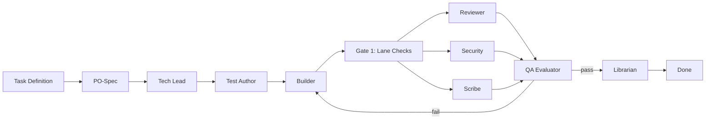

# Pipeline Workflow

The stage graph defines the sequence of role executions for each feature task:

## Stage Sequence
1. **PO-Spec**: Elaborates task requirements into `01-spec.md`.
2. **Tech Lead**: Decomposes implementation into file ownership and test strategy in `03-plan.md` (and ADRs if needed).
3. **Test Author**: Writes failing unit tests and logs red run in `04-tests.md`.
4. **Builder**: Implements code in `src/` to turn tests green, produces `05-build.md`.
5. **Reviewer & Security & Scribe**: Review code, audit security/dependencies, and update documentation (`06-review.md`, `06b-security.md`, `08-docs.md`).
6. **QA Evaluator**: Executes full test suite, confirms AC evidence, issues verdict in `07-qa.md`.
7. **Librarian**: Captures lessons in `docs/memory/lessons.md` and updates `AGENTS.md`.
